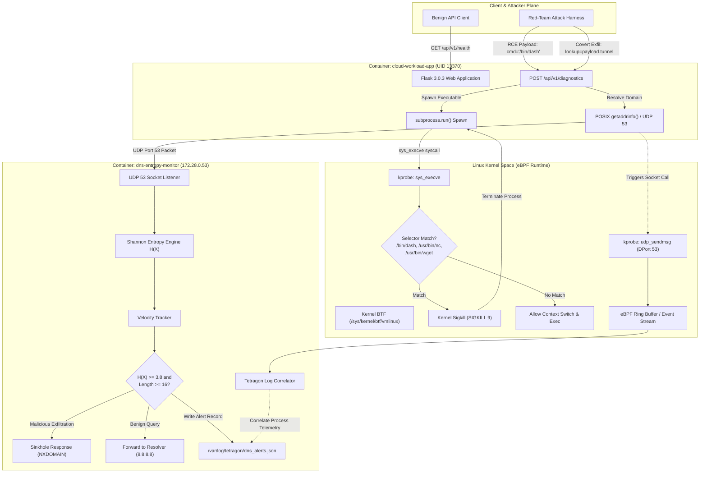

# System Architecture & Technical Specifications

## 1. High-Level Architecture Overview

The **eBPF-Enforced Kernel Runtime Security and Covert DNS Exfiltration Defense System** delivers dual-plane security for containerized multi-tenant cloud workloads:
1. **Kernel-Space Runtime Enforcement:** An eBPF-driven engine operating via Cilium Tetragon that hooks low-level Linux kernel syscalls (`sys_execve`) and network sockets (`udp_sendmsg`, `tcp_connect`), terminating unauthorized process execution synchronously with `SIGKILL` before userspace execution begins.
2. **Userspace DNS Behavioral Inspection:** An asynchronous Shannon Entropy DNS daemon that inspects every outbound UDP port 53 query, computes information-theoretic entropy and query velocity, correlates network sockets with kernel process telemetry from Tetragon, and sinkholes covert data exfiltration tunnels (`iodine` / `dnscat2`).

```
+--------------------------------------------------------------------------------------------------+
|                                        USER SPACE                                                |
|                                                                                                  |
|   +------------------------------------+             +---------------------------------------+   |
|   |   Container: cloud-workload-app    |             |    Container: dns-entropy-monitor     |   |
|   |   (UID 13370 / GID 13370)          |             |    (Python 3 DNS Defense Daemon)      |   |
|   |                                    |             |                                       |   |
|   |   - Python Flask Multi-Tenant API  |             |   - UDP Port 53 Listener & Forwarder  |   |
|   |   - Endpoints:                     |             |   - Shannon Entropy Engine H(X)       |   |
|   |     * /api/v1/health               |             |   - Query Burst Velocity Tracker      |   |
|   |     * /api/v1/tenants              |             |   - Sinkholing Engine (NXDOMAIN)      |   |
|   |     * /api/v1/diagnostics (RCE)    |             |   - Correlator (/var/log/tetragon)    |   |
|   +-----------------+------------------+             +-------------------+-------------------+   |
|                     | DNS Queries (UDP 53)                               |                       |
|                     +----------------------------------------------------+                       |
|                                                                                                  |
|   +------------------------------------------------------------------------------------------+   |
|   |                         Shared Volume: /var/log/tetragon/                                |   |
|   |   tetragon.log (JSON Ring Buffer Export) <---> dns_alerts.json (Structured Audit Log)   |   |
|   +------------------------------------------------------------------------------------------+   |
|                                                     ^                                            |
|                                                     | Event Stream (JSON)                        |
|   +-------------------------------------------------+----------------------------------------+   |
|   |   Container: tetragon (Privileged Host PID Daemon)                                       |   |
|   |   - Userspace Control Agent & BPF Loader                                                 |   |
|   |   - TracingPolicy Parser: /etc/tetragon/tetragon.tp.d/tracing_policy.yaml                 |   |
|   +------------------------------------------------------------------------------------------+   |
+---------------------------------------------|----------------------------------------------------+
                                              | BPF Programs & Ring Buffer
==============================================|=====================================================
                                        KERNEL SPACE                                                
+---------------------------------------------v----------------------------------------------------+
|   eBPF Virtual Machine (Kernel >= 5.15 with BTF /sys/kernel/btf/vmlinux)                         |
|                                                                                                  |
|   +------------------------------------------------------------------------------------------+   |
|   |   kprobe / sys_execve Hook                                                               |   |
|   |   - Intercepts executable path (arg0)                                                    |   |
|   |   - In-Kernel Selector Match: [/bin/dash, /usr/bin/nc, /usr/bin/wget, ...]               |   |
|   |   - Enforcement Action: Synchronous Sigkill via send_sig_info()                          |   |
|   +------------------------------------------------------------------------------------------+   |
|                                                                                                  |
|   +------------------------------------------------------------------------------------------+   |
|   |   kprobe / udp_sendmsg & tcp_connect Hooks                                               |   |
|   |   - Intercepts struct sock *sk targeting DPort 53                                        |   |
|   |   - Emits process context (binary, pid, uid) to eBPF Perf / Ring Buffer                  |   |
|   +------------------------------------------------------------------------------------------+   |
+--------------------------------------------------------------------------------------------------+
```

---

## 2. Mermaid Architecture Workflow



---

## 3. In-Kernel Syscall Enforcement Mechanics

### 3.1 Syscall Interception Point
Traditional user-space agents (such as `LD_PRELOAD` hooks or polling ptrace monitors) operate asynchronously or rely on shared library symbol resolution. Attackers bypass them via static binaries, direct syscall execution, or environment sanitization.

In contrast, this project hooks directly into the kernel entry point for process creation:
$$\text{kprobe:sys\_execve}(\text{struct pt\_regs} *)$$
When a process executes `execve(const char *filename, char *const argv[], char *const envp[])`:
1. The kernel context transitions from user space to kernel space via the `syscall` CPU instruction.
2. The Tetragon eBPF kprobe intercepts the execution request at the very beginning of the syscall handler.
3. Argument 0 (`filename`) is extracted from the register state using BTF (BPF Type Format) typed offsets without user-space dereference latency.
4. Tetragon's in-kernel filter evaluates the string against the configured selector list:
   - `/bin/dash`
   - `/usr/bin/dash`
   - `/bin/nc`
   - `/usr/bin/nc`
   - `/bin/netcat`
   - `/usr/bin/netcat`
   - `/usr/bin/ncat`
   - `/usr/bin/wget`
   - `/bin/wget`

### 3.2 Synchronous In-Kernel Sigkill vs Asynchronous EDR
When a selector condition evaluates to `true`:
- An asynchronous EDR (e.g., standard auditd or legacy Falco configurations) emits an alert to user space, where a user-space daemon parses the event and issues a `kill(pid, SIGKILL)` syscall. This introduces a **Time-of-Check to Time-of-Use (TOCTOU)** race window of 5 to 50 milliseconds, during which malicious shell code or reverse shells can read sensitive tokens or execute payload logic.
- Tetragon's eBPF program immediately triggers `send_sig_info(SIGKILL)` directly within kernel context. The target child process is killed before the kernel returns control to user mode. The process never runs a single user-space instruction.

### 3.3 Host OS Safety Guardrail
Because this evaluation runs on an Ubuntu 22.04/24.04 host VM without Kubernetes pod encapsulation:
- A generic policy terminating `/bin/bash` or `/bin/sh` would kill host login sessions and CI/CD pipelines.
- In Debian/Ubuntu container images (`python:3.11-slim`), `/bin/sh` is a symlink resolving to `/bin/dash`.
- Interactive host terminal sessions run under `/bin/bash` or `/usr/bin/zsh`.
- By scoping the `TracingPolicy` to `/bin/dash` and specific post-exploitation tools (`nc`, `netcat`, `wget`), the host terminal is safeguarded from disruption, while the containerized attack surface is strictly neutralized.

---

## 4. Shannon Entropy DNS Defense Pipeline

### 4.1 Mathematical Formulation of Information Entropy
Covert DNS tunneling tools (`iodine`, `dnscat2`, `dns2tcp`) encode arbitrary binary data (credit cards, passwords, cryptographic keys) into Base64 or Hex subdomains. Human-readable and legitimate algorithmic domains follow natural language phoneme and n-gram distributions with low information density. Encoded ciphertext or compressed binary chunks exhibit maximum randomness and near-uniform character distributions.

Claude Shannon defined the information entropy $H(X)$ of a discrete random variable $X$ with possible outcomes $x_1, x_2, \dots, x_n$ as:

$$H(X) = -\sum_{i=1}^{n} P(x_i) \log_2 P(x_i)$$

Where:
- $n$ is the number of distinct characters observed in the subdomain label.
- $P(x_i) = \frac{\text{count}(x_i)}{L}$ is the empirical probability of character $x_i$ occurring in a label of length $L$.
- $H(X)$ is expressed in **bits per character**.

### 4.2 Decision Engine & Threshold Matrix
The DNS daemon evaluates each incoming query through a three-stage pipeline:
1. **Leftmost Label Extraction:** For `dGVzdC1zZWNyZXQta2V5.01.tunnel.evil-c2.org`, the leftmost payload label `dGVzdC1zZWNyZXQta2V5` is isolated.
2. **Entropy & Length Threshold:**
   $$\text{Anomaly}_{\text{entropy}} \iff (H(X) \ge 3.8 \text{ bits/char}) \land (\text{len}(X) \ge 16 \text{ chars})$$
3. **Query Velocity Anomaly:**
   $$\text{Anomaly}_{\text{velocity}} \iff \text{QueryCount}(\text{ClientIP}, \text{Domain}, \Delta t \le 5\text{s}) \ge 10$$

| Traffic Type | Example Domain Label | $H(X)$ (bits/char) | Length | Daemon Action |
|:---|:---|:---|:---|:---|
| Benign API Gateway | `api` | 1.585 | 3 | Forward to 8.8.8.8 |
| Internal Auth Service | `auth` | 2.000 | 4 | Forward to 8.8.8.8 |
| Cloud Infrastructure | `registry` | 2.522 | 8 | Forward to 8.8.8.8 |
| Encoded Credit Card (Base64) | `Q0MtNDUzMi04OTIxLTk5MjMtMTEwMg` | 4.153 | 28 | Sinkhole (NXDOMAIN) |
| Encoded API Key (Hex) | `736b5f6c6976655f7365635f616c...` | 4.089 | 68 | Sinkhole (NXDOMAIN) |
| Tunnel Command Stream | `ZGJfcGFzc19zdXBlcl9zZWNyZXQ...` | 4.298 | 48 | Sinkhole (NXDOMAIN) |

### 4.3 Sinkholing Mechanism
When classified as `COVERT_EXFIL_DETECTED`:
- The daemon constructs a synthesized DNS response packet with `RCODE = 3 (NXDOMAIN)`.
- The response is returned to the container without forwarding the request to the upstream authoritative nameserver, cutting off the C2 exfiltration channel.
- A structured alert record is appended to `/var/log/tetragon/dns_alerts.json` and printed to `stdout`.

---

## 5. Telemetry Correlation & Shared State

```
+-----------------------------------------------------------------------------------+
|                        Kernel Network Socket Telemetry                            |
|                                                                                   |
|  [udp_sendmsg] -> PID: 13370 | UID: 13370 | Binary: /usr/local/bin/python3        |
|                   Src: 172.28.0.100:49152 -> Dst: 172.28.0.53:53                |
+------------------------------------------+----------------------------------------+
                                           |
                                           v
+-----------------------------------------------------------------------------------+
|                        Tetragon JSON Ring Buffer Stream                           |
|                        (/var/log/tetragon/tetragon.log)                           |
+------------------------------------------+----------------------------------------+
                                           |
                                           v
+-----------------------------------------------------------------------------------+
|               dns-entropy-monitor Background Correlator Thread                    |
|                                                                                   |
|  Matches incoming UDP packet timestamp and source IP with active container       |
|  process metadata recorded by eBPF.                                               |
+------------------------------------------+----------------------------------------+
                                           |
                                           v
+-----------------------------------------------------------------------------------+
|                     Enriched Audit Record (dns_alerts.json)                       |
|                                                                                   |
|  {                                                                                |
|    "timestamp": "2026-10-23T06:12:30.124Z",                                       |
|    "verdict": "COVERT_EXFIL_DETECTED",                                            |
|    "query": "Q0MtNDUzMi04OTIxLTk5MjMtMTEwMg.01.tunnel.evil-c2.org",              |
|    "entropy": 4.153,                                                              |
|    "label_length": 28,                                                            |
|    "client_ip": "172.28.0.100",                                                   |
|    "action": "SINKHOLED_NXDOMAIN",                                                |
|    "correlated_process": {                                                        |
|      "binary": "/usr/local/bin/python3",                                          |
|      "pid": 13370,                                                                |
|      "uid": 13370                                                                 |
|    }                                                                              |
|  }                                                                                |
+-----------------------------------------------------------------------------------+
```

---

## 6. Threat Model & Security Boundaries

### 6.1 Mitigated Threat Scenarios
1. **Remote Code Execution (RCE) via Vulnerable Workload:** An attacker discovers an injection vulnerability in a cloud microservice (simulated by `POST /api/v1/diagnostics`) and attempts to spawn `/bin/dash` or post-exploitation binaries. Intercepted and killed in kernel space before command execution.
2. **Reverse Shell Establishment:** An attacker uses netcat (`nc`) or custom binaries to establish an egress TCP shell. Blocked by kernel-level `sys_execve` enforcement.
3. **Covert Data Tunneling over DNS:** An attacker or malware uses DNS queries to bypass network firewalls that permit port 53 egress. Subdomains encoding stolen tenant secrets are identified by Shannon entropy calculation and sinkholed.

### 6.2 Residual Risks & Architectural Boundaries
- **Encrypted DNS Egress (DoH / DoT):** If workloads are allowed outbound TCP 443 or TCP 853 traffic directly to public resolvers, DNS queries bypass the UDP 53 monitor. In production, outbound TCP 443 must be restricted via egress firewall rules, and TLS decryption proxies or Tetragon `tcp_connect` policies must enforce internal resolver routing.
- **Kernel-Level Exploits:** Attackers who achieve ring-0 privilege escalation (e.g., via local kernel vulnerabilities) can detach eBPF kprobes. eBPF provides defense-in-depth against userspace exploitation; host kernel hardening remains foundational.
